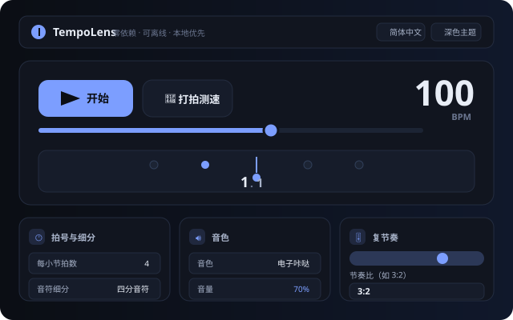
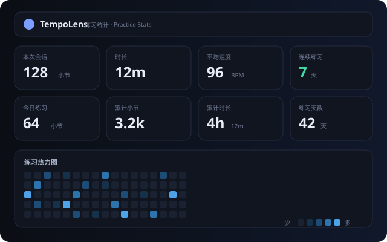

# 🎵 TempoLens

> **零依赖 · 可离线 · 本地优先**的浏览器节拍器与练习工作室
> Zero-dependency, offline-first browser metronome & practice studio

**🌐 语言 / Language / 語言：** **简体中文** · [繁體中文](README.zh-TW.md) · [English](README.en.md)

[](https://github.com/gitstq/TempoLens/actions/workflows/ci.yml)
[](LICENSE)
[](package.json)
[](package.json)

---

## 🎉 项目介绍

**TempoLens** 是一个完全运行在浏览器中的节拍器与音乐练习工作室：打开网页即可练琴，
不需要安装任何软件、不依赖任何网络请求、不追踪任何用户数据。全部音色由 Web Audio
实时合成，全部逻辑均为独立自研实现。

**解决的真实痛点：**

- 🎸 **在线节拍器依赖网络**——练琴时网络波动导致节拍中断，TempoLens 首次打开后永久可用；
- 🥁 **功能单一**——大多数节拍器只有"速度 + 拍号"，缺少复节奏、摇摆、速度阶梯等进阶训练能力；
- 🔐 **隐私顾虑**——各类"云同步"练习工具要求注册登录，练习数据完全暴露给第三方；
- 📦 **臃肿复杂**——动辄数 MB 的框架依赖，TempoLens 全部源码不到 200 KB，单文件即可分发。

**灵感来源与自研差异化：**
项目构思受 GitHub Trending 中"终端原生 / 单文件工具 / 本地优先"趋势启发，针对音乐人
日常练习场景独立自研：以 **Web Audio 预调度引擎**（提前 120ms 规划点击，告别
`setInterval` 抖动）为核心，叠加**复节奏模式、智能 Tap Tempo、速度阶梯、练习例程、
打卡热力图**等进阶能力，并用一套完整的三语界面覆盖中英文用户。

**技术栈：** 原生 HTML + CSS + JavaScript（ES5 兼容 UMD 模块），零运行时依赖；
Node.js（≥18.17）仅用于开发期的语法校验、单元测试与单文件打包。

---

## ✨ 核心特性

- ⏱️ **精准节拍引擎** —— Web Audio 预调度（look-ahead scheduling），音频层按
  `AudioContext.currentTime` 精确触发，不受页面帧率影响；后台标签页被降频时自动丢弃积压；
- 🥁 **复节奏（Polyrhythm）模式** —— 支持 2:3、3:4、4:5 等任意双声部叠加，
  自动计算最小公倍循环长度，复合节奏训练利器；
- 🎚️ **摇摆律动（Swing）** —— 0–100% 连续可调，满值时反拍精确落在三连音位置（2/3 拍）；
- 🎯 **智能 Tap Tempo** —— 带中位数离群值拒绝与超时重置的打拍测速，连打 4 次即可稳定测速；
- 📈 **速度阶梯（Tempo Ladder）** —— 一键生成"从 60 到 120、每级 +5、每级 4 小节"的渐进训练；
- 📋 **练习例程（Routine）** —— 多步骤顺序播放，到时间自动切换速度/拍号/细分，支持
  导入导出 JSON 与本地保存；
- 🔥 **练习统计** —— 会话小节数、时长、加权平均速度、连续打卡天数与 17 周练习热力图，
  数据只存在你自己的浏览器里；
- 🎨 **三语界面** —— 简体中文 / 繁體中文 / English 完整翻译，自动跟随浏览器语言；
- 🌗 **深浅双主题** —— 跟随系统或手动切换，`prefers-reduced-motion` 友好；
- 🔗 **设置分享** —— 全部设置编码进 URL 哈希，一条链接即开即用；
- 📴 **完全离线** —— 首次加载后无任何网络请求，`file://` 直接打开也能运行；
- 🧩 **零依赖零构建** —— 没有 `node_modules`，没有打包器，没有 CDN，源码即文档。

---

## 🚀 快速开始

### 方式一：直接打开（零安装）

无需安装任何东西——直接用浏览器打开 `src/index.html` 即可使用
（双击文件或拖入浏览器窗口均可，支持 `file://` 协议）。

### 方式二：本地开发服务器（可选）

```bash
# 要求 Node.js >= 18.17（仅开发期使用，应用本身零依赖）
node scripts/serve.mjs --port 8080
# 打开 http://localhost:8080/
```

### 方式三：单文件便携版

```bash
node scripts/build.mjs        # 产出 dist/tempolens.html（约 130 KB）
```

`dist/tempolens.html` 是内联了全部样式与脚本的**单文件应用**，可随意拷贝、
发送邮件、放进 U 盘，双击即可运行。

### 开发期校验（全部零依赖）

```bash
npm run check     # 语法校验：node --check 覆盖全部源码
npm test          # 单元测试：node --test（核心引擎全覆盖）
npm run build     # 单文件打包
npm run smoke     # 冒烟测试：进程内启动静态服务器验证关键资源
npm run verify    # 一键执行以上四项
```

---

## 📖 详细使用指南

### 🎛️ 基本演奏

| 操作 | 方式 |
|---|---|
| 开始 / 停止 | 点击 **▶ 开始** 按钮，或按 <kbd>空格</kbd> |
| 调整速度 | 拖动速度滑杆、输入数字，或 <kbd>↑</kbd>/<kbd>↓</kbd>（<kbd>Shift</kbd> ±10） |
| Tap 测速 | 点击 **👋 打拍测速** 或按 <kbd>T</kbd>，跟随音乐敲击 4 次以上 |
| 快速静音 | <kbd>M</kbd> |
| 切换细分 | <kbd>1</kbd>–<kbd>4</kbd> 对应四分/八分/三连音/十六分音符 |

### 🧭 拍号与细分

- **每小节拍数**：1–16 任意设置（含 5、7 等奇数拍）；
- **音符细分**：四分 / 八分 / 三连音 / 十六分，视觉区会显示口癖计数（`1` `e` `&` `a`）；
- **重音模式**：每小节重拍 / 每拍重音 / 无重音；
- **预备拍**：开始前播放 1–2 小节计数，统计自动从正式演奏开始累计。

### 🥁 复节奏训练（特色功能）

1. 勾选 **启用复节奏**；
2. 输入节奏比，如 `3:2`（左手每 3 拍 3 下、右手每 2 拍 2 下的经典叠加）；
3. 可设置独立基准速度，或留空跟随主速度；
4. 面板会显示循环长度（如 `6 拍 · 3000 ms`），两个声部以不同音高区分。

> 💡 **练习建议**：先用 `2:3` 慢速熟悉，再逐步过渡到 `3:4`、`4:5`。

### 📈 速度阶梯与练习例程

在 **练习例程** 卡片中：

1. 展开 **生成速度阶梯**，填写 从/到/每级幅度/每级小节，点击生成；
2. 也可以点击 **添加步骤** 手动编排，每步可单独设置速度、小节数、细分；
3. 点击 **播放例程**，到时间自动切换到下一步，面板实时显示 `第 2/6 步`；
4. 支持 **导出例程**（JSON）与 **导入例程**，方便备份和分享。

### 🔥 练习统计与打卡

- 每次演奏自动记录小节数、时长与加权平均速度；
- 17 周热力图一眼看出练习规律，连续打卡天数激励每日练习；
- 数据存储于浏览器 `localStorage`，**不上传、不同步、可随时清除**。

### 🔗 设置分享

点击 **复制分享链接**，当前全部设置（速度、拍号、细分、摇摆、音色、复节奏…）
会编码进 URL 哈希；对方打开链接即得到完全一致的配置。

### 🖼️ 界面预览

| 演奏舞台 | 练习统计 |
|---|---|
|  |  |

> 演示动图与更多截图占位：正式版发布后补充。

---

## 💡 设计思路与迭代规划

### 设计理念

- **预调度优于定时器**：`setInterval` 受事件循环与标签页降频影响，误差可达数十毫秒。
  TempoLens 每帧只做一件事：把未来 120ms 内的点击规划出来并交给音频层按绝对时间播放，
  视觉层则消费同一事件队列，做到"所见即所听"；
- **纯函数核心 + 薄壳 UI**：所有节拍数学（`core/` 目录）都是无副作用纯函数，
  可在 Node 中直接单元测试；DOM 与音频只做薄封装；
- **零依赖是特性不是限制**：不锁定任何框架版本，源码可读、可审计、可永久维护；
- **隐私优先**：没有账号、没有后端、没有遥测，练习数据完全属于用户。

### 技术选型原因

| 选型 | 原因 |
|---|---|
| 原生 JS + UMD | 浏览器全局与 Node 测试双兼容，无需打包器 |
| Web Audio 合成音色 | 零音频素材，三种音色全部实时合成 |
| `localStorage` | 零后端实现统计与例程持久化 |
| CSS 自定义属性 | 深浅双主题零 JS 成本切换 |
| `node --test` | 零依赖测试运行器，CI 无需 `npm install` |

### 迭代规划 / Roadmap

- [ ] 不规则拍号（如 3+3+2 加法节奏）与自定义重音 pattern
- [ ] 练习例程的随机/洗牌模式
- [ ] 录音对比（记录演奏并与节拍对齐回放）
- [ ] PWA 支持（Service Worker 完全离线缓存）
- [ ] 更多音色与音量包络自定义
- [ ] 练习数据导入/导出（JSON 备份）

### 社区贡献方向

欢迎参考 [CONTRIBUTING.md](CONTRIBUTING.md)：新增语言翻译、补充测试用例、
实现 Roadmap 功能、改进无障碍体验都是非常好的起点。

---

## 📦 打包与部署指南

### 本地打包

```bash
node scripts/build.mjs
# 产物：dist/tempolens.html（单文件，内联全部样式与脚本）
```

### 部署

TempoLens 是**纯静态应用**，任何静态托管都可以：

| 平台 | 操作 |
|---|---|
| GitHub Pages | 推送 `src/` 目录（或 `dist/` 单文件）到 `gh-pages` 分支，Settings → Pages 开启 |
| Vercel / Netlify | 拖拽 `src/` 文件夹即可，无需构建命令 |
| 任意 Web 服务器 | Nginx/Apache 指向 `src/` 目录即可 |
| 离线分发 | 直接发送 `dist/tempolens.html` 单文件 |

### 兼容环境

- **浏览器**：Chrome / Edge / Firefox / Safari 近两年任意现代版本（需支持 Web Audio；
  不支持时自动退化为纯视觉模式）；
- **桌面端**：Windows 10+ / macOS 11+ / Linux（任意现代发行版）；
- **移动端**：iOS Safari 15+ / Android Chrome（响应式布局，支持触屏）；
- **开发工具**：Node.js ≥ 18.17（仅语法校验、测试、打包需要）。

### CI 质量门禁

每次推送与 PR 都会在 GitHub Actions 云端执行（Ubuntu / Windows / macOS × Node 20/22 矩阵）：

1. `node scripts/check-syntax.mjs` —— 全量语法校验；
2. `node --test test/` —— 单元测试；
3. `node scripts/build.mjs` —— 单文件打包；
4. `node scripts/smoke.mjs` —— 静态服务器冒烟测试。

---

## 🤝 贡献指南

- 提交 Issue 前请阅读 [CONTRIBUTING.md](CONTRIBUTING.md)，Bug 请附复现步骤与环境信息；
- PR 请遵循 **Angular 提交规范**（`feat:` / `fix:` / `docs:` / `refactor:` …）；
- 提交前本地执行 `npm run verify` 确保全部通过；
- 新增界面文案必须同步更新三种语言（zh-CN / zh-TW / en）；
- 严禁引入运行时依赖——这是本项目的核心约束。

---

## 📄 开源协议说明

本项目基于 [MIT](LICENSE) 协议开源：

- ✅ 可自由使用、复制、修改、合并、发布、分发，包括商业用途；
- ✅ 唯一要求：在副本或重要衍生作品中保留原始版权声明与许可声明；
- ❌ 不提供任何担保（"AS IS"），作者不对使用造成的任何损失负责。

Copyright © 2026 TempoLens contributors.
